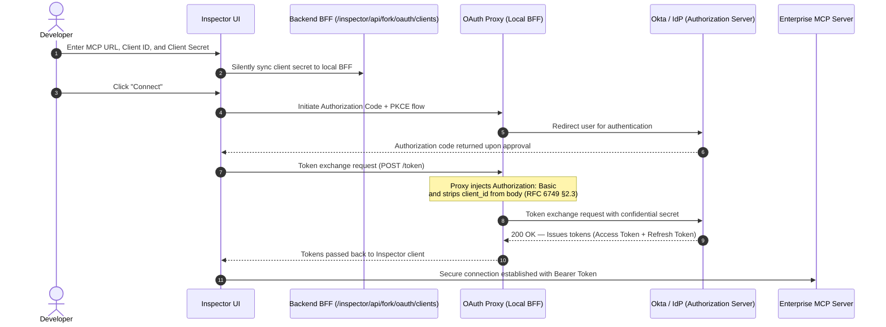

# Enterprise OAuth & Confidential Clients Guide (Okta / Enterprise)

> Support for **OAuth Confidential Clients** enables the Inspector to authenticate against enterprise MCP servers protected by strict Identity Providers (**Okta**, **Ping Identity**, **Azure AD**, **Keycloak**) requiring a pre-registered `client_id` and `client_secret` using the `client_secret_basic` authentication method.

---

## 1. Background & Context

The upstream `mcp-use` OAuth implementation was originally designed around Dynamic Client Registration (*RFC 7591*) for public clients.

However, in corporate and enterprise environments:
1. **Mandatory Pre-Registration:** Client applications must be pre-registered within the corporate identity management portal (e.g. Okta, Azure AD) with approved redirect URIs.
2. **Confidential Credentials:** Token exchange requests mandate a `client_secret` transmitted as an HTTP `Authorization: Basic <base64(client_id:client_secret)>` header (*RFC 6749 §2.3.1*).
3. **Browser Security:** A client secret must never be exposed directly in client-side browser network requests to the authorization server, nor persisted in insecure configuration files.

The fork introduces a **Backend-For-Frontend (BFF)** proxy mechanism that handles secure secret injection locally during the token exchange, guaranteeing strict compliance with enterprise identity providers.

---

## 2. Authentication Flow Architecture



---

## 3. Configuring OAuth Credentials

Three configuration methods are supported based on your use case:

### Method A: Directly via the Inspector UI (Recommended for local dev)
1. Open the Inspector (`http://localhost:3017/inspector`).
2. In the connection form, select **OAuth**.
3. Fill in:
   - **Server URL:** e.g. `https://mcp.example.com/mcp`
   - **Client ID:** Your OAuth application client ID
   - **Client Secret:** Your OAuth application client secret
4. Click **Connect**.
5. The transparent `<ForkStaticClientsSync />` component remembers the secret in an isolated local storage key (`mcp-inspector-fork-oauth-secrets`) and synchronizes it to the local BFF proxy. Future page reloads retain this configuration automatically without re-entry.

---

### Method B: Environment Variable (Ideal for Docker and CI/CD)
You can pre-configure one or more confidential servers at Inspector startup via the `FORK_OAUTH_STATIC_CLIENTS` JSON environment variable:

```bash
export FORK_OAUTH_STATIC_CLIENTS='[
  {
    "serverUrl": "https://mcp.example.com/mcp",
    "clientId": "enterprise-client-app-id",
    "clientSecret": "my-ultra-confidential-secret",
    "authMethod": "client_secret_basic"
  }
]'

# Start the inspector
./scripts/fork/run-local.sh --url https://mcp.example.com/mcp
```

---

### Method C: BFF REST API
The Inspector exposes dedicated management endpoints on its local server:

- **Register / Update a client:**
  ```bash
  curl -X PUT http://localhost:3017/inspector/api/fork/oauth/clients \
    -H "Content-Type: application/json" \
    -d '{
      "resource": "https://localhost:8443/mcp",
      "clientId": "my-client-id",
      "clientSecret": "my-secret",
      "authMethod": "client_secret_basic"
    }'
  ```

- **Delete a client:**
  ```bash
  curl -X DELETE "http://localhost:3017/inspector/api/fork/oauth/clients?resource=https%3A%2F%2Flocalhost%3A8443%2Fmcp&clientId=my-client-id"
  ```

---

## 4. Okta Specifics & RFC 6749 §2.3 Compliance

When authenticating against strict authorization servers like Okta:
- **RFC 6749 §2.3 Rule:** A token request must **never** combine multiple client authentication methods.
- **Common Gotcha Handled by Fork:** When adding the `Authorization: Basic base64(id:secret)` header, the `client_id` parameter must be removed from the POST request body. The fork proxy enforces this rule, preventing the common Okta rejection:
  > *"Cannot supply multiple client credentials. Use one of the following: credentials in the Authorization header, credentials in the post body, or a client_assertion in the post body."*

---

## 5. Security & Confidentiality

- **Zero Secret Logging:** Proxy logs never print secret values—only the authentication method (`client_secret_basic`) and destination URL.
- **Isolated Storage:** Secrets are never persisted into upstream's public connection state (`mcp-inspector-connections`), preventing leaks in profile or session exports.
